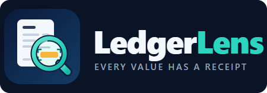
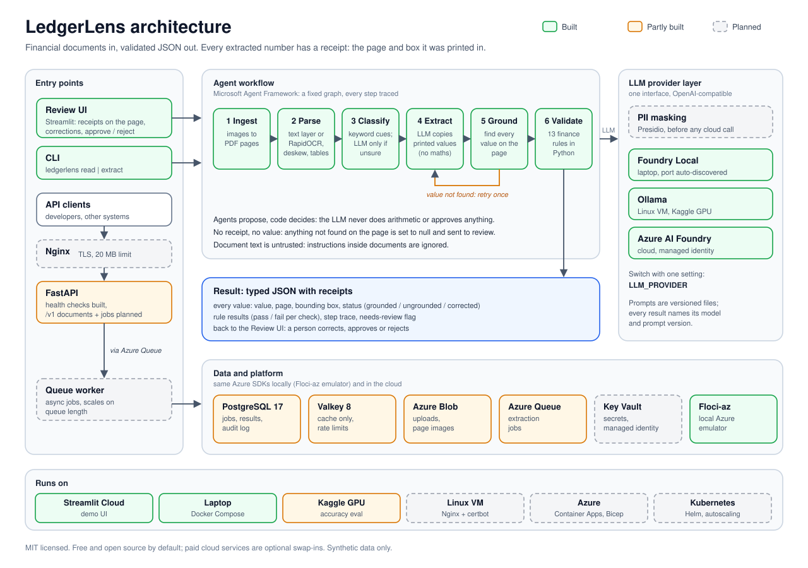

<p align="center">
  
</p>

[](docs/ARCHITECTURE.md)

<sub>Click the diagram for the full architecture with detailed diagrams.</sub>

LedgerLens is open-source document intelligence for fintech. It turns messy financial documents (bank statements, invoices, receipts, pay slips, W-2s) into validated JSON. Every value is tied to where it appears on the page and is checked by deterministic finance rules. A value that can't be grounded is flagged for review, never guessed.

It is built to run fully locally and free (Foundry Local + Floci-az + open-source OCR), and to move to Azure AI Foundry with a config switch.

> **Status:** Phase 2. Foundations, schemas, finance rules and a synthetic generator with exact ground truth, plus parsing (PDF text layer + RapidOCR with deskew) and a baseline LLM extractor. Parse recall on synthetic data: **99.7%** of printed values found at their true position ([report](reports/eval_2026-11-26_parse.md)). Grounding is in: every value the model proposes must be found on the page, or it's removed and sent to review (849/849 fields and 2,287/2,287 rows grounded at their true position on 80 unseen synthetic documents). The agent workflow (Microsoft Agent Framework: parse -> classify -> extract -> ground -> validate, with one grounding-driven retry) and a Streamlit review screen are in. Architecture, with what is built and what is planned: [docs/ARCHITECTURE.md](docs/ARCHITECTURE.md). Full specification: [spec.md](spec.md).

## Quickstart

Needs Python 3.12, [uv](https://docs.astral.sh/uv/), Docker, and [Foundry Local](https://github.com/microsoft/Foundry-Local) (or Ollama).

```bash
cp .env.example .env
uv sync                          # install dependencies
docker compose up -d             # Floci-az, PostgreSQL, Valkey, Jaeger, API
uv run alembic upgrade head      # create database tables
uv run ledgerlens init-storage   # create blob container + jobs queue
uv run ledgerlens hello          # one prompt through the configured LLM
curl localhost:8000/readyz       # every backing service should report "ok"
```

Generate synthetic test documents (clean, scanned-looking and tampered, each with a `.truth.json`):

```bash
uv run python -m synth --count 20   # -> data/synth/{bank_statement,invoice}/
```

Read any PDF or image (JPEG, PNG, TIFF, BMP, WebP) with the text layer or OCR, no LLM needed:

```bash
uv run ledgerlens read invoice_photo.jpg   # prints the page as Markdown, tables kept
```

Run the full pipeline on one PDF or image (needs an LLM: Foundry Local, Ollama or Azure AI Foundry):

```bash
uv run ledgerlens extract statement.pdf --doc-type bank_statement -o result.json
```

Images are turned into image-only PDF pages, so photos and scans take the same OCR path as scanned PDFs, and receipts are in the same page coordinates.

Review UI (works offline in replay mode, no LLM needed):

```bash
uv sync --extra ui
uv run streamlit run ui/streamlit_app.py
```

Pick a synthetic sample, see every value boxed on the page, and try a *tampered* statement to watch reconciliation fail and the document go to review. Uploading your own document is off by default; turn it on with `LEDGERLENS_ALLOW_UPLOAD=1`. Uploads accept PDF, JPEG, PNG, TIFF, BMP and WebP, and run in one of two modes:

- **Read with OCR (no LLM):** the text and a box for every word (blue: PDF text layer, green: OCR, red: OCR unsure), the Markdown the extractor would get, and a document-type guess.
- **Full extraction (needs an LLM):** fields, receipts, finance checks and review, as for the samples.

### Deploy the demo on Streamlit Community Cloud (free)

1. Sign in at [share.streamlit.io](https://share.streamlit.io) with GitHub and choose **Create app**.
2. Repository: this repo · Branch: `main` · Main file path: `ui/streamlit_app.py`.
3. **Advanced settings:** Python **3.12**.
   - **Public app:** leave `LEDGERLENS_ALLOW_UPLOAD` unset, so it shows synthetic documents only.
   - **Private app** (Settings → Sharing → only invited viewers): to allow uploads, add `LEDGERLENS_ALLOW_UPLOAD = "1"` under **Secrets**. Without an LLM configured there, uploads run in *Read with OCR* mode.
4. Deploy. Dependencies come from `ui/requirements.txt`; the first visit generates 12 synthetic samples (a few seconds).

After a push that changes files other than `ui/streamlit_app.py`, use **Manage app → Reboot app**: a live update can keep old copies of imported modules in memory and fail with an `ImportError`.

Vercel can't host Streamlit: its serverless functions don't keep the WebSocket connection Streamlit needs.

No GPU? [notebooks/kaggle_eval.ipynb](notebooks/kaggle_eval.ipynb) runs the extraction eval on a free Kaggle GPU with an open model.

Run the checks with `uv run pytest` (unit) and `uv run pytest -m integration` (needs the compose stack).

## Why

Generic LLM extraction fails regulated finance teams in three ways:

- **Hallucination:** it returns values that aren't in the document.
- **Lost structure:** tables, multi-page statements and checkboxes get mangled.
- **No audit trail:** nobody can see where a number came from.

LedgerLens addresses each one. Every field carries a source span (page, bounding box, OCR text), a confidence score and a validation status.

## How it works

```
Preprocess → Parse/OCR → Classify → Extract → Validate → Ground & reconcile → Review
```

- **Parse/OCR:** Docling, PaddleOCR/RapidOCR, Tesseract, pypdfium2, pdfplumber
- **Agents:** Microsoft Agent Framework, as a deterministic workflow graph. Agents propose; code decides.
- **Validation:** plain-Python finance rules, e.g. `opening + credits − debits = closing`, invoice totals, IBAN mod-97
- **Grounding:** each value is fuzzy-matched to OCR spans; ungrounded values become `null` and are flagged
- **LLM backends:** Foundry Local, Ollama/vLLM, or Azure AI Foundry, behind one OpenAI-compatible interface

## Example output

```json
{
  "doc_type": "bank_statement",
  "fields": {
    "opening_balance": {
      "value": "1520.40",
      "confidence": 0.97,
      "source": {"page": 1, "bbox": [72, 110, 240, 124]},
      "status": "grounded"
    }
  },
  "validation": [
    {"rule": "balance_roll_forward", "status": "pass"}
  ]
}
```

Money is always stored as decimal strings, never floats.

## Planned stack

Python 3.12 · uv · FastAPI · Streamlit · Microsoft Agent Framework · Docling · PostgreSQL · Valkey (Redis-compatible) · Floci-az (local Azure emulation) · Nginx · Presidio (PII masking) · OpenTelemetry · pytest · Docker Compose

Everything needed to build, run and demo LedgerLens is free and open source. Paid cloud services are optional swap-ins, never requirements.

## Roadmap

| Phase | Deliverable |
|-------|-------------|
| 0 | Repo, CI, docker-compose with Floci, Foundry Local "hello" |
| 1 | Synthetic generator for bank statements and invoices with ground truth |
| 2 | Parse/OCR → Markdown with bboxes; baseline LLM extraction |
| 3 | Agent workflow, grounding, rules, review UI |
| 4 | Eval harness on CORD, FinTabNet and synthetic data, with published numbers |
| 5 | VM demo, 3-minute video; optional Azure deployment |

## Data and privacy

LedgerLens uses **synthetic or public data only**. Datasets are downloaded into `data/`, which is git-ignored and never committed. No real personal financial documents.

## License

MIT, see [LICENSE](LICENSE). Core dependencies must be MIT-compatible, so GPL/AGPL libraries are avoided.
