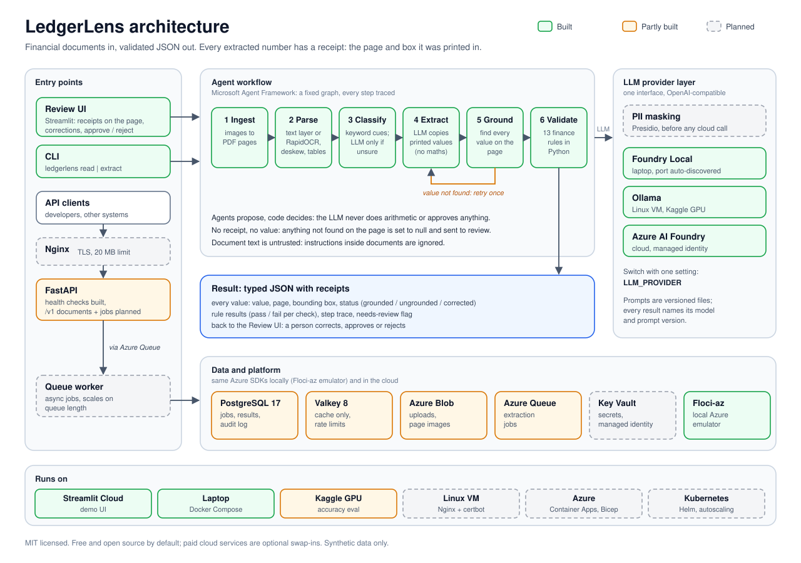
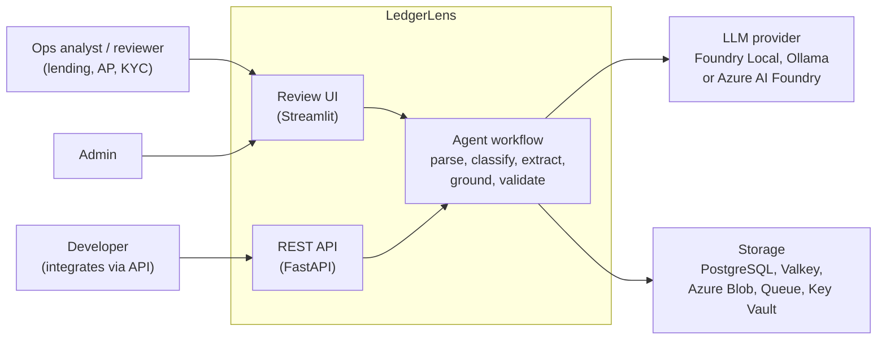
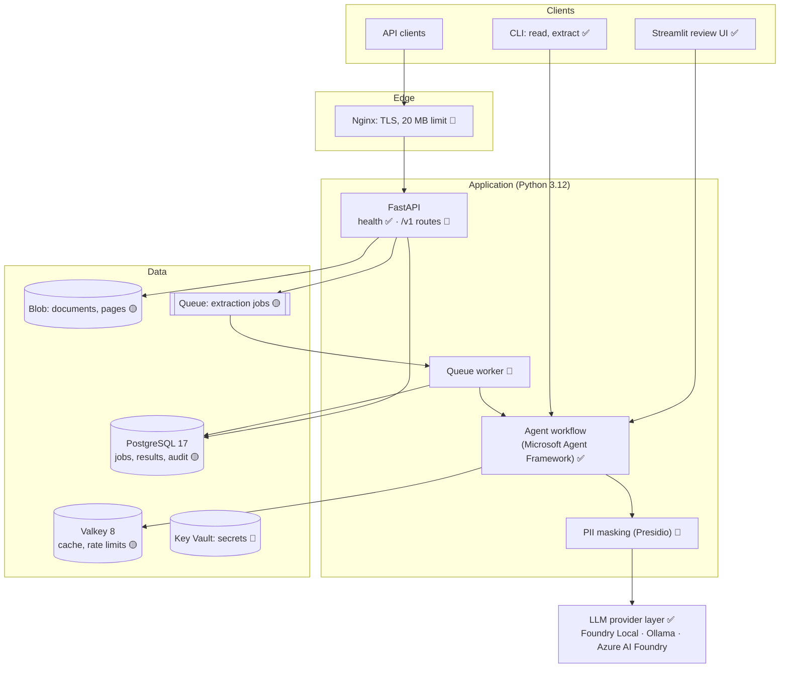
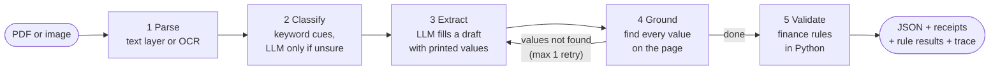
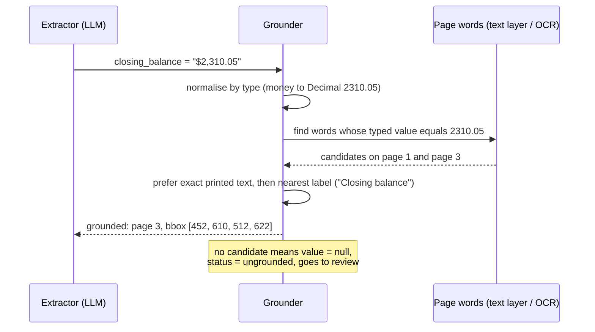
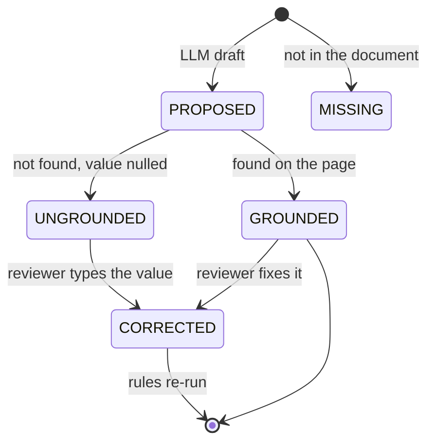
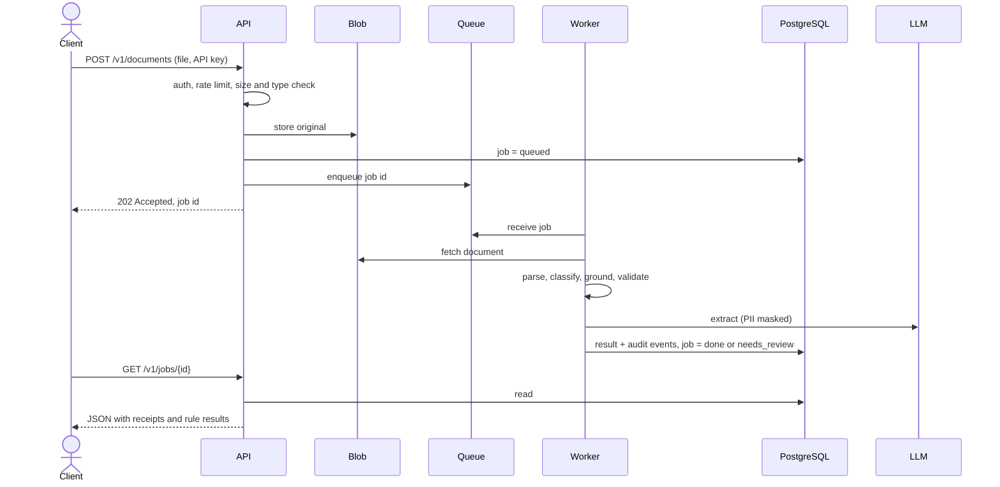
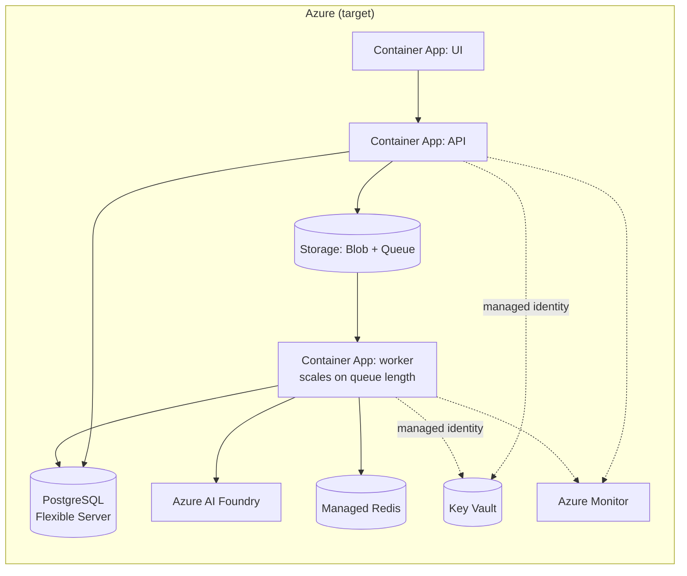

# LedgerLens architecture

LedgerLens turns financial documents (PDFs, scans, phone photos) into typed JSON where **every value has a receipt**: the page and the box it was printed in. Values that can't be found on the page are never guessed; they are left empty and sent to a person.



This document describes the system as designed, and marks honestly what runs today:

| Mark | Meaning |
| --- | --- |
| ✅ | Built, tested, in CI |
| 🟡 | Partly built (foundations exist, not wired end to end) |
| 🔲 | Designed, not built yet |

---

## 1. Design principles

1. **Agents propose, code decides.** The LLM only copies what is printed into a schema. Plain Python checks every value against the page and does all arithmetic. A model can't "approve" a document.
2. **Grounding or nothing.** Every non-empty value must match text on the page (page + bounding box). If it doesn't, it becomes `null` with status `ungrounded` and goes to review.
3. **Deterministic workflow, not a chat loop.** The agent pipeline is a fixed graph with one bounded retry, so it is testable, repeatable and auditable.
4. **Money is `Decimal`, never `float`.** Amounts serialise as decimal strings; comparisons use a 0.01 tolerance.
5. **Document text is untrusted.** Prompts forbid following instructions found in documents, and output that doesn't fit the JSON schema is rejected.
6. **Free and open source by default.** Everything runs locally for free (MIT-compatible licences only). Paid cloud services are optional swap-ins behind the same interfaces.
7. **One switch to the cloud.** Local emulators and providers use the same SDKs and APIs as Azure, so moving is configuration, not a rewrite.

---

## 2. System context



| Actor | Needs |
| --- | --- |
| Ops analyst / reviewer | See each value next to its source on the page, fix what's wrong, approve or reject |
| Developer | One API call: document in, validated JSON with receipts out |
| Admin | Control who may upload, limits and which model runs |

---

## 3. Components



Today the UI and CLI call the workflow in-process. The target adds the API → queue → worker path so uploads are processed asynchronously, survive restarts and are recorded in PostgreSQL.

---

## 4. The agent workflow ✅

Built with Microsoft Agent Framework as a fixed graph of executors (`ledgerlens/agents/workflow.py`). Every step appends to a trace (step name, duration and what it decided) that the UI shows and the audit log will store.



| Step | What happens | Code |
| --- | --- | --- |
| 0. Ingest | Images (JPEG, PNG, multi-page TIFF, BMP, WebP) become image-only PDF pages at A4 width; phone rotation is applied | `pipeline/ingest.py` |
| 1. Parse | Per page: use the PDF text layer when it has real text, otherwise render at 200 DPI and OCR with RapidOCR. Both paths produce the same word spans (text + box in PDF points). Scans are deskewed from OCR line angles. Lines are grouped into column-aware Markdown tables | `pipeline/parse.py`, `ocr.py`, `spans.py` |
| 2. Classify | Count keyword cues per type (e.g. "opening balance", "invoice no"). A clear winner skips the LLM entirely; otherwise the LLM decides between the known types or "other" | `agents/classifier.py` |
| 3. Extract | The LLM gets the Markdown and a versioned prompt, and returns a draft with values **as printed** (no maths, no reformatting). Invalid JSON gets one repair attempt, then the job fails | `agents/extractor.py`, `agents/prompts/` |
| 4. Ground | Each value is searched for among the page's words (see §5). Values not found are reported back, and extraction is retried once for those keys only. What's still missing becomes `null` / `ungrounded` | `pipeline/ground.py` |
| 5. Validate | Deterministic rules (see §6) produce pass / fail / warn / skip per rule. Any failure or ungrounded value marks the document for review | `rules/` |

Unsupported document types stop after step 2 with a clear message; they can still be read with OCR (step 1 only).

---

## 5. Grounding: how a value gets its receipt ✅



- **Typed matching** for money and dates: `$2,310.05`, `2.310,05 €` and `2310.05` all match the same `Decimal`; dates match across printed formats.
- **Fuzzy matching** for text (rapidfuzz score ≥ 90) tolerates small OCR slips without accepting different words.
- **Tie-breaking** when a number appears more than once: exact printed text first, then the closest label word.
- **Rows** (transactions, invoice lines) are grounded as a whole line, so each row has its own box.

Field status lifecycle:



---

## 6. Validation rules ✅

| Document | Rule | Checks |
| --- | --- | --- |
| Bank statement | `balance_roll_forward` | opening + credits − debits = closing |
| | `running_balance_consistency` | every row's balance follows from the previous one |
| | `dates_within_period` | transaction dates inside the statement period |
| | `no_duplicate_rows` | no row repeated (e.g. across page breaks) |
| | `printed_totals_match` | printed totals equal the sum of rows |
| Invoice | `line_amounts` | qty × unit price = line amount |
| | `lines_sum_to_subtotal` | lines add up to the subtotal |
| | `total_arithmetic` | subtotal + tax − discount = total |
| | `due_on_or_after_issue` | due date ≥ issue date |
| | `iban_mod97` | IBAN checksum is valid |
| | `tax_id_format` | VAT / tax ID matches the country's format |
| All | `currency_iso4217`, `all_values_grounded` | valid currency code; every value has a receipt |

Rules are pure functions, property-tested with hypothesis. Tampered synthetic documents must fail exactly the rules they were tampered for.

---

## 7. Data model

Every field is wrapped in the same envelope (`schemas/base.py`):

```json
"closing_balance": {
  "value": "2310.05",
  "status": "grounded",
  "confidence": 0.99,
  "source": { "page": 3, "bbox": [452.1, 610.4, 512.8, 622.0] }
}
```

- `bbox` is `[x0, y0, x1, y1]` in PDF points, top-left origin, pages 1-based. Scans and photos use the same space.
- Account numbers and IBANs are masked when stored (`****1234`).
- Each document type is one Pydantic model registered in `schemas/__init__.py::REGISTRY`; adding a type means a schema, a prompt, rules and a synthetic generator.

PostgreSQL tables (migration `0001`, 🟡 not written to by the pipeline yet):

| Table | Holds |
| --- | --- |
| `jobs` | one row per document: status, type, blob path, file hash, page count, result JSON (JSONB), error |
| `audit_events` | append-only events per job (event, actor, JSONB detail): model and prompt version, rule results, reviewer decisions and corrections |

---

## 8. Infrastructure roles

| Service | Role | Must never | Status |
| --- | --- | --- | --- |
| PostgreSQL 17 | System of record: jobs, results, audit log, review queue, API-key hashes | lose data; schema changes only via Alembic | 🟡 schema + migrations + health check |
| Valkey 8 | Cache only: OCR/LLM results by page hash, rate-limit counters, progress events | hold anything that can't be recomputed | 🟡 client + key scheme + health check |
| Azure Queue | Extraction jobs between API and worker | — | 🟡 wrapper, verified on Floci |
| Azure Blob | Raw uploads, page images, result files | keep uploads longer than the retention window | 🟡 wrapper, verified on Floci |
| Key Vault | Runtime secrets | — | 🔲 |
| Floci-az | Local emulator for Blob / Queue / Key Vault (same SDKs as Azure) | — | ✅ used in CI integration tests |

**Why these choices**

- **PostgreSQL over Table Storage / Cosmos DB:** the review queue and audit log need real queries (by status, reviewer, date) and transactions, and Postgres runs the same on a laptop and in Azure.
- **Valkey over Redis:** Redis 8's licence includes AGPL/SSPL; Valkey is the BSD fork and wire-compatible.
- **Azure Queue for jobs, not Redis:** the cache may be flushed at any time; a job must never be lost with it.

---

## 9. LLM provider layer ✅

All model calls go through one interface (`llm/provider.py`), selected by `LLM_PROVIDER`:

| Provider | Where | Notes |
| --- | --- | --- |
| `foundry_local` | Windows / macOS laptop | port discovered with `foundry-local-sdk`, never hard-coded |
| `ollama` | Linux VM, Kaggle GPU notebook | qwen2.5:7b for the accuracy eval |
| `azure_foundry` | Azure | Entra ID / managed identity, no keys |

All three speak the OpenAI-compatible API, so prompts, retries and parsing are identical. Prompts are versioned files (`v1.md`); a change means a new version, never an in-place edit, so every result can be traced to the exact prompt.

---

## 10. Request lifecycle (target) 🔲



---

## 11. Deployment views

| View | What runs | LLM | Status |
| --- | --- | --- | --- |
| **Streamlit Community Cloud** | Review UI with the in-process pipeline; synthetic samples; uploads only when the app is private and `LEDGERLENS_ALLOW_UPLOAD` is set | none (replay of synthetic truth); OCR runs | ✅ |
| **Laptop** | `docker compose up`: Floci, PostgreSQL, Valkey, Jaeger, API | Foundry Local or Ollama on the host | ✅ (stack + health) |
| **Kaggle notebook** | Same code, Ollama on a free GPU, for accuracy evaluation | qwen2.5:7b | 🟡 notebook ready, not run yet |
| **Single Linux VM** | Compose stack behind Nginx + certbot | Ollama | 🔲 |
| **Azure** | Container Apps (API, worker, UI), Blob, Queue, Key Vault, PostgreSQL Flexible Server, Managed Redis, managed identity; Bicep | Azure AI Foundry | 🔲 |
| **Kubernetes** | Helm chart; worker scales on queue length | Ollama / Azure AI Foundry | 🔲 |



---

## 12. Security and data protection

| Risk | Control | Status |
| --- | --- | --- |
| Secrets leaking | Only `.env.example` in git; gitleaks in pre-commit and CI; Key Vault + managed identity at runtime | ✅ gitleaks · 🔲 Key Vault |
| Real personal data in a public demo | Public deployments are synthetic-only; uploads need a private app and an explicit flag | ✅ |
| Personal data sent to a cloud LLM | Presidio masks names, account numbers, IDs and emails before any cloud call or log line | 🔲 |
| Stored identifiers | Account numbers and IBANs masked in every stored result | ✅ |
| Prompt injection inside documents | System prompt forbids following document instructions; schema-only output; values must still be grounded, so injected text can't create numbers | ✅ |
| Hallucinated values | Grounding nulls anything not on the page; rules re-check arithmetic | ✅ |
| Hostile uploads | Size limit (20 MB), page cap (50), type sniffing, image pixel limit, files not kept | ✅ UI · 🔲 API |
| Abuse and cost | API keys (hashed in PostgreSQL), per-key rate limits in Valkey | 🔲 |
| Licence risk | No GPL / AGPL / SSPL dependencies; CI licence gate | ✅ |
| Accountability | Audit log of model, prompt version, rule results and reviewer decisions per job | 🟡 trace + decision files · 🔲 PostgreSQL |

**Healthcare.** The architecture is sector-agnostic (any document type is a schema + rules), but real health data brings legal duties (HIPAA, GDPR special-category data). LedgerLens only processes synthetic healthcare records today; they are supported in read-only OCR mode.

---

## 13. Quality and evaluation

| Gate | Where |
| --- | --- |
| ruff (lint + format), mypy strict | CI, every push |
| 300+ unit and property tests (pytest, hypothesis) | CI |
| Integration tests against PostgreSQL, Valkey and Floci containers, Alembic up and down | CI |
| Licence gate (no GPL/AGPL/SSPL), gitleaks | CI |

Measured on synthetic documents with exact ground truth (`eval/`, `reports/`):

| Measure | Result |
| --- | --- |
| Parse recall (printed values found at the true position) | 279 / 280 fields (99.7%), 602 / 602 rows |
| Grounding on 80 unseen documents | 849 / 849 fields, 2,287 / 2,287 rows at the true position |
| Classification from cues alone | 20 / 20 templates, no LLM needed |
| Real-LLM extraction accuracy | pending: Kaggle run with qwen2.5:7b |

---

## 14. Key decisions

| Decision | Chosen | Instead of | Because |
| --- | --- | --- | --- |
| Pipeline shape | Fixed graph, one bounded retry | Free-form agent chat loop | Testable, repeatable, auditable; cost is bounded |
| Trust model | Ground every value + deterministic rules | Model confidence scores | A confident model can still invent a number; a missing receipt can't be hidden |
| Parsing | pdfplumber + RapidOCR (ONNX) + own deskew and table Markdown | Docling (PyTorch) | Runs on an 8 GB laptop and free cloud tiers; 99.7% recall. Docling stays an optional comparison |
| Images | Convert to image-only PDF pages | A separate image pipeline | One code path, one coordinate system for receipts |
| Classification | Keyword cues first, LLM only when unsure | LLM for every document | Free, instant and deterministic for the common case |
| LLM access | One OpenAI-compatible interface, three providers | A single vendor SDK | Local, VM and cloud with one setting; no lock-in |
| Demo hosting | Streamlit Community Cloud | Vercel | Streamlit needs long-lived WebSockets, which serverless functions don't keep |
| Licences | MIT-compatible only | PyMuPDF, Marker, Surya (GPL/AGPL) | Anyone, including banks, can self-host and modify it |

---

## 15. What's next

1. **API and worker:** `/v1/documents`, `/v1/jobs/{id}`, queue consumer, results and audit events in PostgreSQL.
2. **Access control:** admin login, API keys, per-key limits; later, user quotas.
3. **PII masking** with Presidio before any cloud LLM call, then a hosted LLM for uploads.
4. **Real-LLM evaluation** on Kaggle and public datasets (CORD, FinTabNet), published in `reports/`.
5. **More document types:** receipts, pay slips, W-2.
6. **Deployment:** single VM with Nginx, then Azure with Bicep.

---

## Code map

| Path | Contents |
| --- | --- |
| `ledgerlens/pipeline/` | ingest, parse, OCR, spans and Markdown, grounding, `process_pdf` |
| `ledgerlens/agents/` | workflow graph, classifier, extractor, drafts, versioned prompts |
| `ledgerlens/schemas/` | Pydantic models per document type, field envelope |
| `ledgerlens/rules/` | deterministic validators |
| `ledgerlens/llm/` | provider layer |
| `ledgerlens/storage/`, `db/`, `cache.py` | Azure Blob / Queue, PostgreSQL models, Valkey |
| `ledgerlens/api/` | FastAPI app |
| `ui/` | Streamlit review UI and its testable logic |
| `synth/` | synthetic document generators with exact ground truth |
| `eval/` | metrics, runners, reports |
| `App_Test/` | synthetic fintech and healthcare files for trying the app |
